# Pawnix

[](https://github.com/a-shygun/Pawnix/actions/workflows/ci.yml)
[](https://pypi.org/project/pawnix/)
[](https://pypi.org/project/pawnix/)
[](LICENSE)

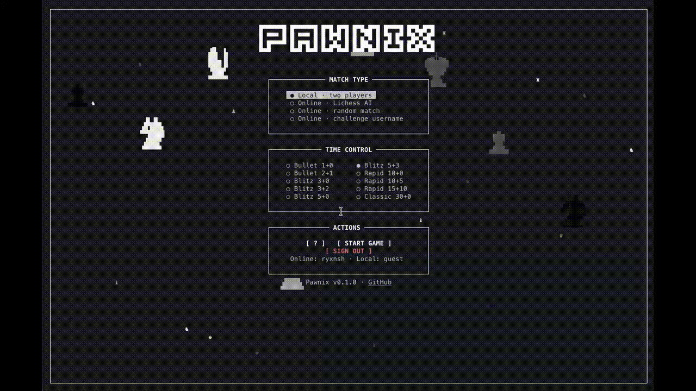

Pawnix is a keyboard-first chess client for the terminal. Play over-the-board
chess locally or connect to Lichess for AI practice, casual matchmaking, and
username challenges. It combines a responsive curses interface with
[`python-chess`](https://python-chess.readthedocs.io/) for standard chess rules.

## Features

- Local two-player games with clocks, SAN/UCI input, castling, promotion,
  undo/redo, draw controls, and PGN import/export.
- Lichess AI games, casual online matches, direct challenges, premoves, and
  draw offers through the official Board API.
- Browser-based Lichess sign-in using OAuth with PKCE. Credentials are stored
  in the operating system's credential store.
- Fifteen preset board themes, terminal-resizing piece sizes, zoom, coordinates,
  move review, captured pieces, and board annotations.
- Public Lichess profile lookup without signing in.

## Installation

Pawnix requires Python 3.10 or newer and a UTF-8 terminal. macOS and Linux are
supported. Color support is optional; a no-color fallback is included.

### PyPI

Use `pipx` to install Pawnix in an isolated environment:

```sh
pip install pawnix
pawnix
```

Or install it into the active Python environment:

```sh
python -m pip install pawnix
pawnix
```

### Homebrew

The formula is in this repository:

```sh
brew tap a-shygun/Pawnix https://github.com/a-shygun/Pawnix
brew install pawnix
```

### Nix

Run directly from the repository flake:

```sh
nix run 'github:a-shygun/Pawnix?dir=packaging/nix'
```

### Linux release downloads

Tagged GitHub releases include standalone Linux archives and `.deb` packages
for amd64 and arm64. Download the matching `.deb` from
[Releases](https://github.com/a-shygun/Pawnix/releases), then install it with:

```sh
sudo apt install ./pawnix_<version>_linux_amd64.deb
```

Standalone `.tar.gz` downloads are also available for Linux and macOS. The
release page includes SHA-256 checksums.

### From source

```sh
git clone https://github.com/a-shygun/Pawnix.git
cd Pawnix
python3 -m venv .venv
source .venv/bin/activate
python -m pip install -e .
pawnix
```

## Using the CLI

With no arguments, `pawnix` opens the interactive welcome screen. Choose a match
type and clock there, then press **Start Game**.

```sh
pawnix --help
pawnix --version
pawnix --minutes 3 --increment 2 --theme ocean
```

`--minutes` accepts 1–180 minutes per player; `--increment` accepts 0–180
seconds per move. Defaults are 5 minutes and a 3-second increment. `--theme`
sets a preset for this run. Available theme keys are `sand`, `walnut`, `copper`,
`parchment`, `mist`, `ocean`, `ice`, `olive`, `moss`, `stone`, `silver`,
`graphite`, `linen`, `violet`, and `wood4`.

Look up a public Lichess profile in plain text or JSON:

```sh
pawnix profile DrNykterstein
pawnix profile DrNykterstein --json
```

### Controls

| Input | Action |
| --- | --- |
| Click a piece, then a destination | Select and move a piece |
| Type SAN or UCI, then Enter | Enter a move, such as `Nf3` or `e2e4` |
| Arrow keys / WASD | Navigate the focused setup options |
| Tab | Move between setup boxes |
| `=` / `-` | Zoom the board in / out |
| `T` / `t` | Cycle themes forward / backward |
| `V` | Move the side panel |
| `G` | Toggle gaps between board squares |
| `C` | Toggle board coordinates |
| `R` | Toggle piece rain |
| `?` | Open the quick guide |
| `Q` in a match | Open the forfeit-and-exit confirmation |
| Right-click / right-drag | Circle a square / draw an arrow |

The in-game guide lists controls and shortcuts. Local games also support
restart, undo/redo, pause, draw offers and claims, autosave/resume, and PGN
import/export. In Lichess games, click or drag one of your pieces during the
opponent's turn to queue a premove.

## Lichess

Sign in from the welcome screen to play Lichess AI, join a casual random match,
or challenge a username. Pawnix uses the official Board API and requests
`board:play` and `challenge:write` access. Sign-in opens Lichess in your browser;
Pawnix does not ask for your Lichess password. OAuth credentials are kept in
your operating system's credential store. Public profile lookup does not
require an account.

Pawnix's online games are casual. Pawnix does not provide engine assistance
during online games. See the [Lichess developer guidance](https://lichess.org/developers),
[Terms of Service](https://lichess.org/terms-of-service), and
[Fair Play policy](https://lichess.org/page/fair-play).

## Themes

Choose a preset in the app or start a session with `pawnix --theme <key>`. The
screenshots below show the complete board and piece palette for each preset.

| Sand · `sand` | Walnut · `walnut` | Rust · `copper` |
| --- | --- | --- |
| 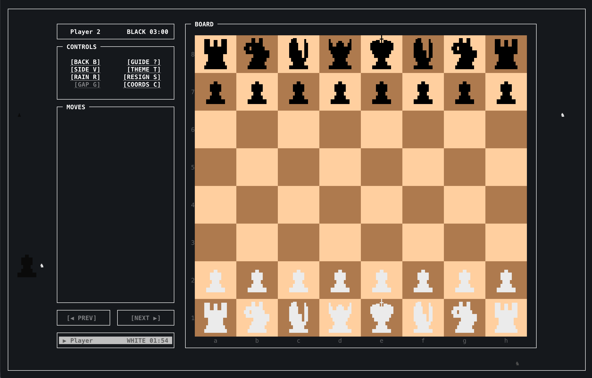 | 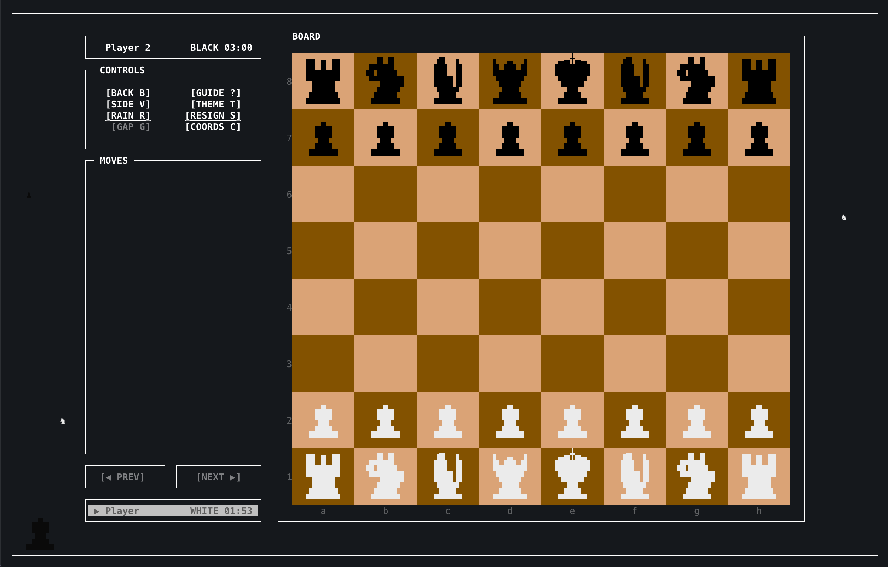 |  |

| Parchment · `parchment` | Mist · `mist` | Ocean · `ocean` |
| --- | --- | --- |
| 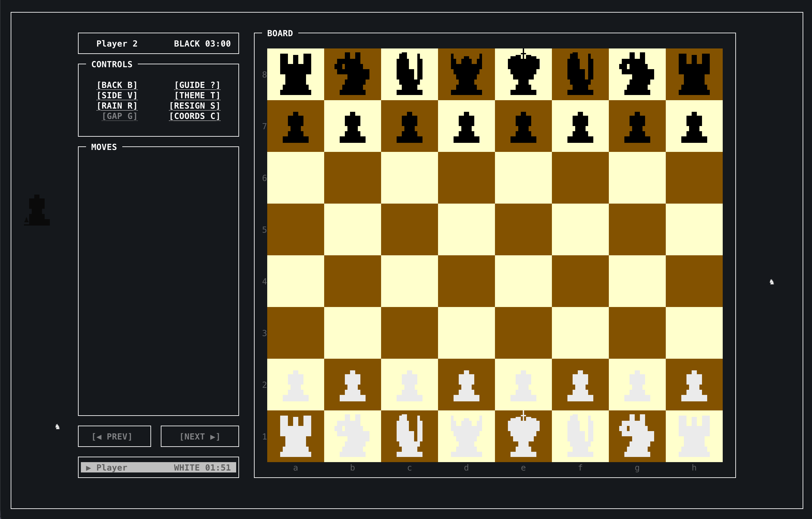 | 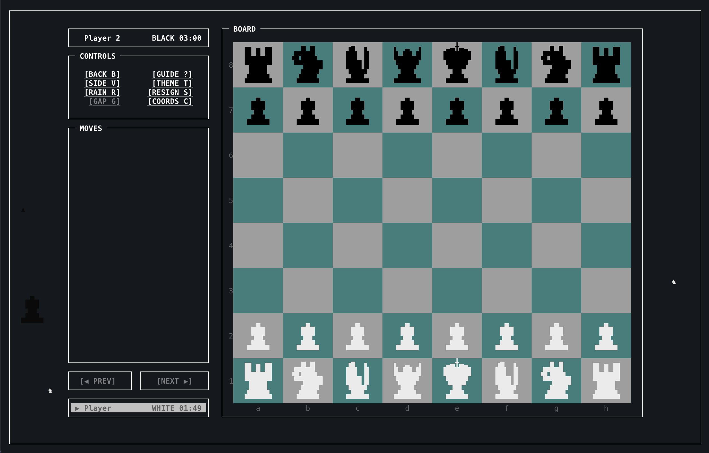 | 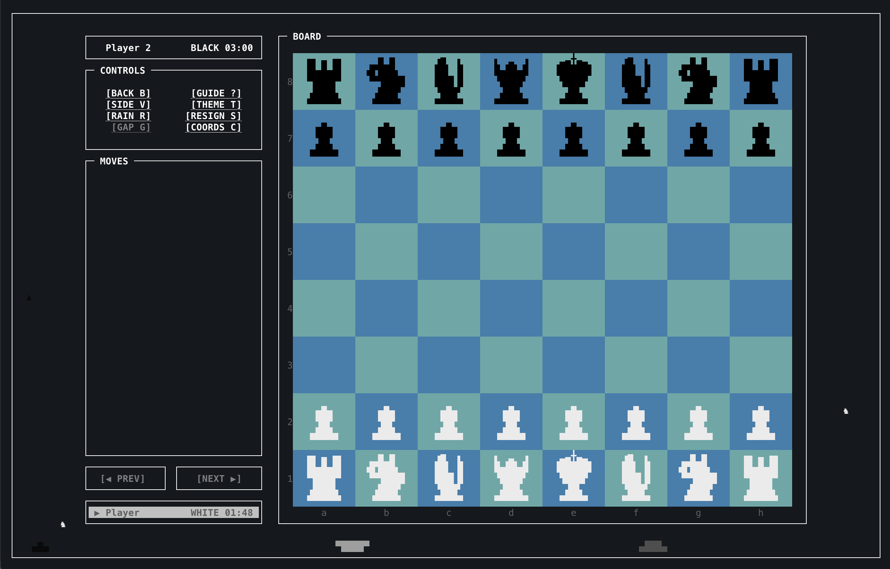 |

| Ice · `ice` | Olive · `olive` | Moss · `moss` |
| --- | --- | --- |
| 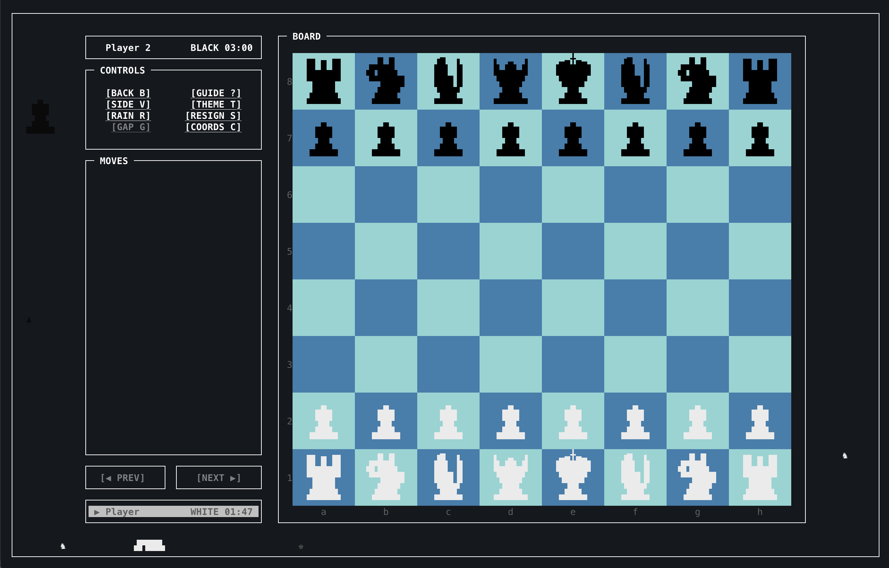 | 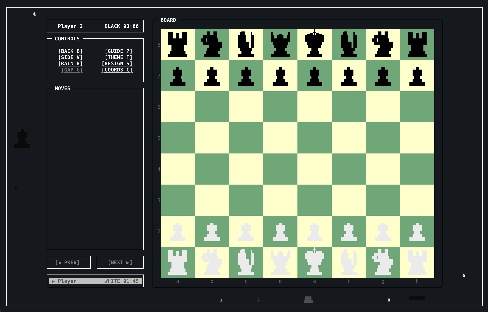 |  |

| Stone · `stone` | Steel · `silver` | Graphite · `graphite` |
| --- | --- | --- |
| 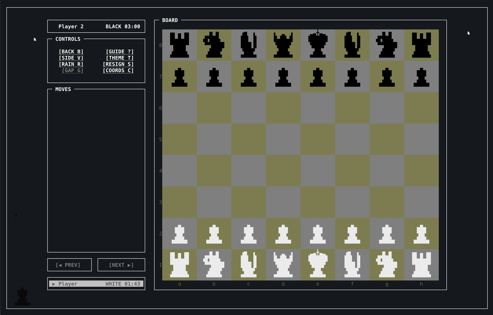 | 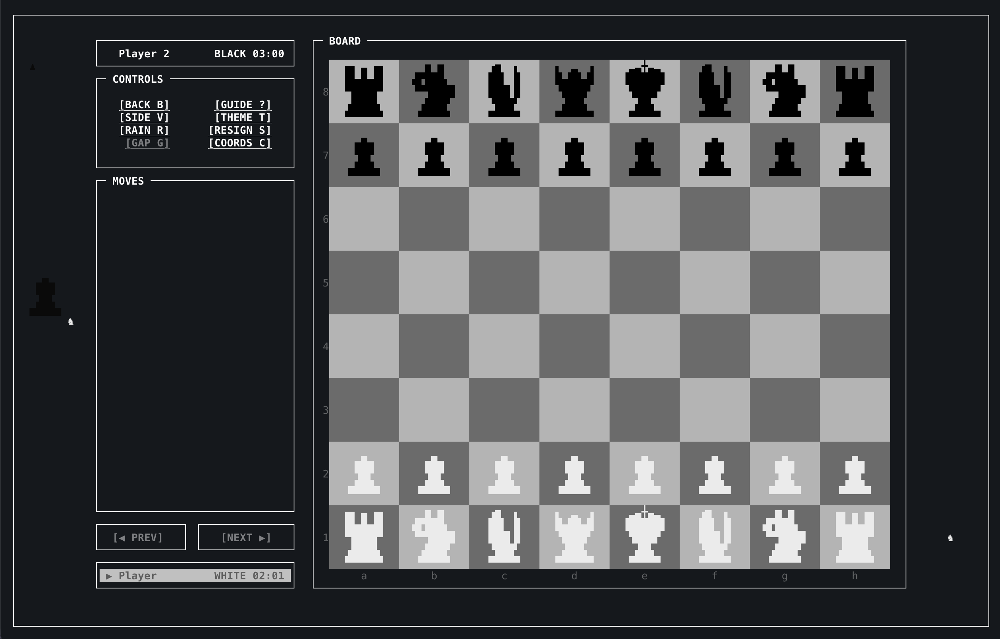 | 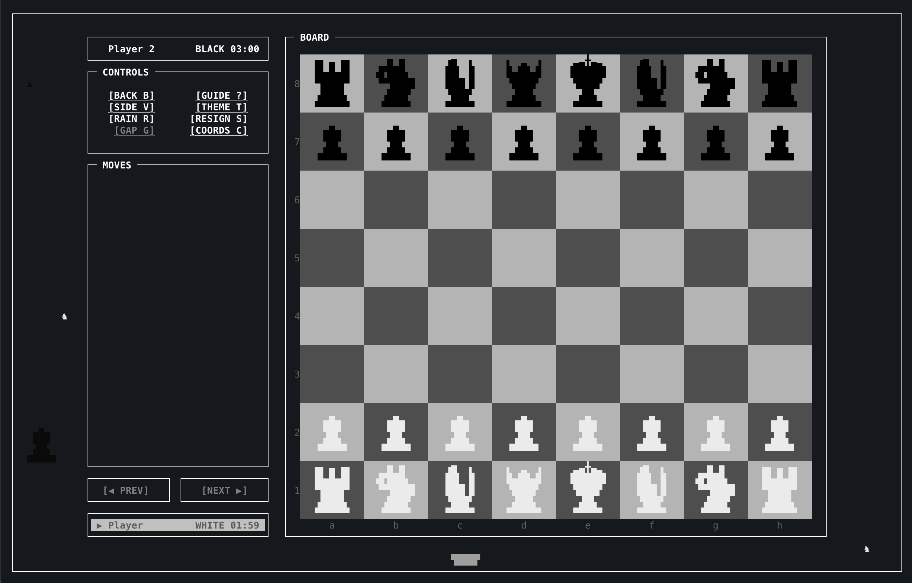 |

| Linen · `linen` | Mauve · `violet` | Wood4 · `wood4` |
| --- | --- | --- |
| 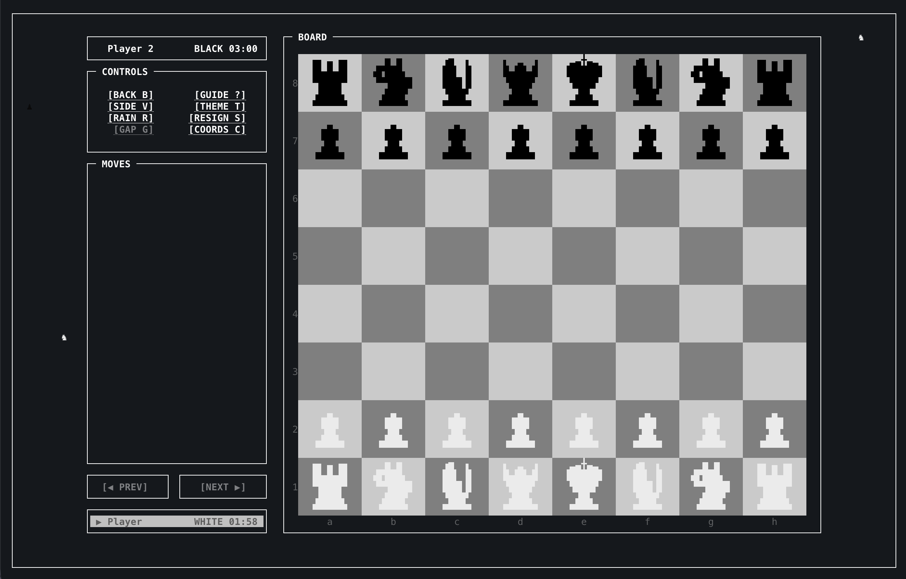 | 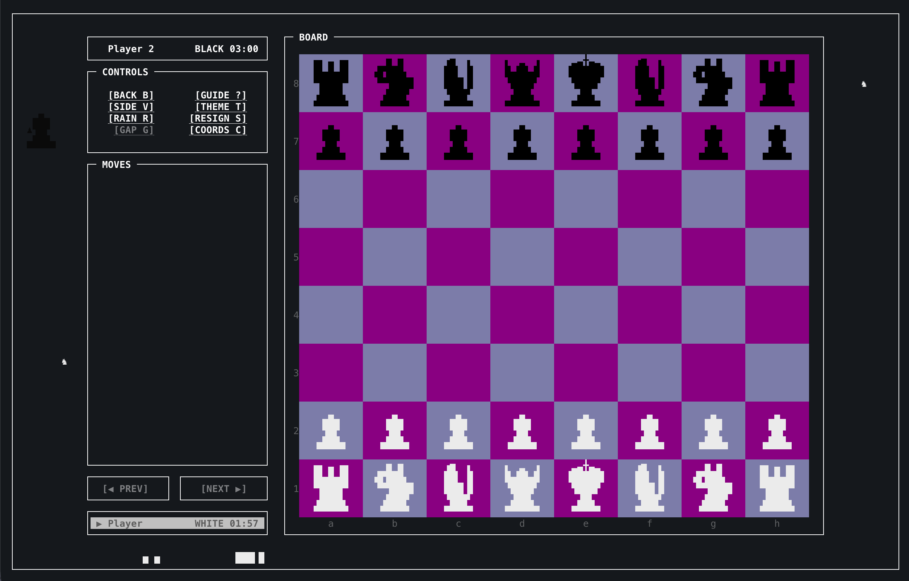 |  |

## Project layout

```text
src/pawnix/
  cli.py                 CLI parsing and command dispatch
  game/                  chess session, clocks, PGN, and autosave
  lichess/               OAuth, credentials, profile, and Board API client
  ui/                    curses app, renderers, controls, themes, and dialogs
assets/
  pawnix.gif             animated terminal demo
  themes/                theme preview images
Formula/pawnix.rb        Homebrew formula
packaging/nix/           Nix flake and package definition
.github/workflows/       CI and tag-based release automation
```

## Project checklist

### Implemented

- [x] Local standard chess with legal move handling, clocks, review, and PGN
      save/load.
- [x] Lichess sign-in, AI practice, casual matchmaking, challenges, premoves,
      and draw actions.
- [x] Responsive terminal board, themes, zoom, mouse input, and keyboard
      shortcuts.
- [x] CI plus tag-based PyPI publishing and GitHub release assets; Homebrew
      formula and Nix packaging are included.

### Good next steps

- [ ] Add automated tests for chess flows, terminal layout, and Lichess API
      responses.
- [ ] Recover cleanly from interrupted online-game connections and support
      Board API draw claims.
- [ ] Improve accessibility options and terminal-specific color/layout
      handling.
- [ ] Explore local UCI engine analysis as a separate offline feature.

## Release process

Set the version in `pyproject.toml`, push a matching tag such as `v0.1.0`, and
GitHub Actions builds the Python packages, platform archives, Linux `.deb`
installers, checksums, and GitHub release. The workflow publishes to PyPI and
updates the Homebrew formula; publishing to a separate Homebrew tap is optional
and uses repository secrets. Nix users can build from `packaging/nix/`.

## Repository history

[](https://app.repohistory.com/star-history)

## License

Pawnix is released under the [MIT License](LICENSE).
